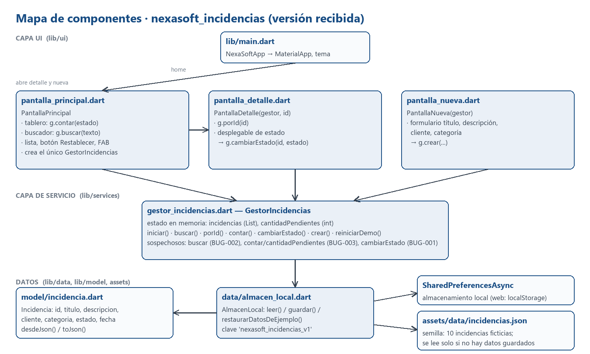
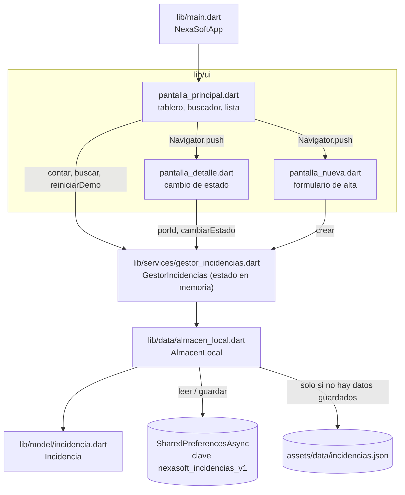

# Día 1 — Notas de investigación

Práctica 01 · NexaSoft Solutions · Mantenimiento de `nexasoft_incidencias`
Fecha: 13/10/2026 · Entorno: Flutter 3.47.4 / Dart 3.13.3, Windows 11, Chrome 155 (web).

Alcance del día: preparar el proyecto, explorar el código, dibujar el mapa de componentes y
**reproducir** BUG-001, BUG-002 y BUG-003. Hoy **no se modificó ningún archivo de `lib/` ni de `assets/`**;
las correcciones corresponden al día 2.

## 1. Preparación

| Paso | Comando / acción | Resultado |
|---|---|---|
| 1 | Copiar `nexasoft_incidencias/` y la guía al repo `Paquete01`, `git init` | Commit `e49195b` (estado inicial, tal como se recibió) |
| 2 | `flutter create . --project-name nexasoft_incidencias --platforms android,web,windows` | Carpetas `android/`, `web/`, `windows/` generadas |
| 3 | `flutter pub get` | Dependencias resueltas. Aviso: *Building with plugins requires symlink support* (falta Modo de desarrollador de Windows) |
| 4 | `flutter devices` | Windows (desktop), Chrome (web), Edge (web) |
| 5 | `flutter analyze` | 3 avisos `info`, 0 errores (ver sección 6) |
| 6 | `flutter test` | 1 prueba, pasa (`Una incidencia antigua puede convertirse desde JSON`) |
| 7 | Commit de las carpetas nativas | Commit `cf3dfd6` |
| 8 | `flutter run -d web-server --web-port 8123` y abrir en Chrome | La app inicia y muestra 10 incidencias |

`flutter create` añadió un bloque `exclude` a `analysis_options.yaml` y `pub get` actualizó `pubspec.lock`;
son los únicos archivos existentes que cambiaron.

## 2. Mapa de componentes

Cómo fluye la información:

- `PantallaPrincipal` crea **un solo** `GestorIncidencias` y se lo pasa a las otras dos pantallas.
  No hay gestor de estado (Provider, etc.): al volver de otra pantalla hace `setState(() {})` y vuelve a
  preguntar al gestor.
- `GestorIncidencias` guarda la lista en memoria (`incidencias`) y un entero aparte (`cantidadPendientes`).
- `AlmacenLocal.leer()` usa lo guardado en almacenamiento local si existe; si no, carga la semilla JSON.
  `guardar()` serializa **la lista completa**. `restaurarDatosDeEjemplo()` solo borra la clave.
- En web el almacenamiento local es el `localStorage` del navegador para el origen `localhost:8123`.

## 3. Datos de partida (conteo manual sobre la semilla)

| Estado | IDs | Total |
|---|---|---|
| Pendiente | INC-101, 103, 105, 108, 110 | 5 |
| En proceso | INC-102, 106 | 2 |
| Resuelta | INC-104, 107, 109 | 3 |
| | | **10** |

El tablero inicial muestra 5 / 2 / 3 y "10 registros": coincide (E01).

## 4. Reproducción de los fallos

Cada sesión de prueba abre Chrome con un perfil aislado y lo **cierra por completo** al terminar, de modo
que "reiniciar" significa cerrar el navegador y volver a abrirlo, no recargar la pestaña.

### BUG-002 — La búsqueda omite registros existentes — REPRODUCIDO

| Consulta | Esperado | Obtenido | Evidencia |
|---|---|---|---|
| `wifi` | 1 (INC-102) | 0 registros, "No se encontraron incidencias" | E02 |
| `WiFi` | 1 (INC-102) | 1 (INC-102) | E03 |
| `túnel` | 1 (INC-106, por su descripción) | 0 registros | E04 |
| `  WiFi  ` (con espacios) | 1 (INC-102) | 0 registros | extra/X1 |
| (vacío) | 10 | 10 | — |

Hipótesis (lectura de `GestorIncidencias.buscar`, `lib/services/gestor_incidencias.dart` líneas 15-18):
la comparación es `x.titulo.contains(texto)`, es decir (a) distingue mayúsculas, (b) solo mira el título y
(c) usa el texto sin recortar: `trim()` solo se aplica para decidir si la consulta está vacía.
Las cuatro pruebas son coherentes con esa hipótesis. Pendiente de confirmar corrigiendo en el día 2.

### BUG-001 — El cambio de estado desaparece — REPRODUCIDO

Registro usado: **INC-101** "Impresora del almacén no responde".

| Momento | Estado de INC-101 | Almacenamiento local | Evidencia |
|---|---|---|---|
| Antes del cambio (detalle) | Pendiente | vacío | E05 |
| Después de elegir *Resuelta* (detalle) | Resuelta | vacío | E06 |
| De vuelta en la lista | Resuelta | **vacío** (no existe la clave `nexasoft_incidencias_v1`) | E07 |
| Tras cerrar y reabrir Chrome | **Pendiente** | vacío | E08 |

Hipótesis: `cambiarEstado` (líneas 32-39) modifica el objeto en memoria pero nunca llama a
`datos.guardar(...)`; `crear` (línea 54) sí lo hace. Comprobación: tras el cambio de estado el
`localStorage` sigue vacío, y al reabrir `leer()` no encuentra nada y vuelve a la semilla.

Hallazgos adicionales:

- **Registrar una incidencia sí persiste** (criterio 3 del ticket): "Monitor sin señal en caja 2" seguía
  ahí tras reiniciar (E09 → E10).
- **El defecto es intermitente por un efecto secundario.** Se cambió INC-103 a *En proceso* y, sin
  reiniciar, se registró una incidencia nueva. Tras reiniciar, INC-103 **seguía En proceso** (E10), porque
  `crear` guarda la lista completa con todo lo que hubiera en memoria. Esto explica por qué el cliente ve
  el fallo "a veces" y es un caso que la corrección debe seguir cubriendo.
- Segundo caso: INC-104 pasó de *Resuelta* a *Pendiente* (E11) y al reabrir volvió a *Resuelta*.

### BUG-003 — El tablero presenta cantidades incorrectas — REPRODUCIDO

| Paso | Tablero (Pend. / En proc. / Res.) | Conteo manual en la lista | ¿Coincide? | Evidencia |
|---|---|---|---|---|
| Estado inicial | 5 / 2 / 3 (10 registros) | 5 / 2 / 3 | Sí | E01 |
| INC-101 Pendiente → Resuelta | **5** / 2 / 4 (suma 11, hay 10) | **4** / 2 / 4 | No | E07 |
| Reinicio (el cambio se pierde, BUG-001) | 5 / 2 / 3 | 5 / 2 / 3 | Sí | E08 |
| INC-103 Pendiente → En proceso | **5** / 3 / 3 (suma 11, hay 10) | **4** / 3 / 3 | No | extra/X2 |
| Registrar incidencia nueva | **6** / 3 / 3 (suma 12, hay 11) | **5** / 3 / 3 | No | E09 |
| Reinicio | 5 / 3 / 3 (11 registros) | 5 / 3 / 3 | Sí | E10 |
| INC-104 Resuelta → Pendiente | **5** / 3 / 2 (suma 10, hay 11) | **6** / 3 / 2 | No | E11 |

Hipótesis: el total de pendientes no se calcula a partir de la lista. `contar('Pendiente')` devuelve el
campo `cantidadPendientes`, que solo se actualiza en `iniciar()` (recuento real) y en `crear()` (`++`);
`cambiarEstado` no lo toca. Los otros dos estados sí se cuentan sobre la lista, por eso solo falla
"Pendientes" y la suma deja de cuadrar. Al reiniciar se ejecuta `iniciar()` y el número se corrige, lo que
coincide con el "a veces" del reporte. Con la búsqueda activa el tablero no cambió (E02-E04 muestran
5 / 2 / 3), así que los totales ya son independientes del filtro de texto.

## 5. Uso de "Restablecer demostración"

Se usó **una vez**, al final de la sesión, para descartar los registros de prueba (extra/X4 y X5).
Después de restablecer: 10 incidencias, 5 / 2 / 3 y `localStorage` vacío.

## 6. Otras observaciones (sin ticket)

- `flutter analyze`: `value` obsoleto en `DropdownButtonFormField` (`pantalla_detalle.dart:73`,
  `pantalla_nueva.dart:75`) y uso de `BuildContext` tras un `await` (`pantalla_principal.dart:112`).
  No se tocan hoy; anotar para no introducir más avisos.
- La única prueba automática cubre el modelo; no hay pruebas de `GestorIncidencias`, que es donde
  apuntan las tres hipótesis.
- `Incidencia.desdeJson` ya usa valores por defecto para campos ausentes; es el punto natural para el
  valor inicial *Media* de FEAT-001.
- El aviso de symlinks puede bloquear `flutter run -d windows`; en web no afecta.

## 7. Estado de tickets al cierre del día 1

| Ticket | Estado | Respaldo |
|---|---|---|
| BUG-001 | Abierto — reproducido, hipótesis formulada | E05-E08, E10, E11 |
| BUG-002 | Abierto — reproducido, hipótesis formulada | E02-E04, extra/X1 |
| BUG-003 | Abierto — reproducido, hipótesis formulada | E01, E07, E09-E11 |
| FEAT-001 | Abierto — sin iniciar | — |
| FEAT-002 | Abierto — sin iniciar | — |

Las capturas completas están en `docs/dia01/evidencias/` (las `extra/` no se incrustaron en la bitácora).
